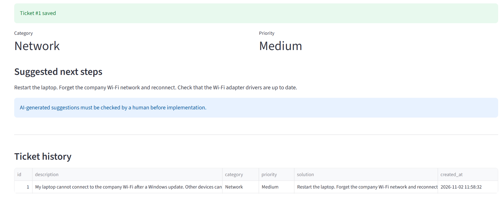
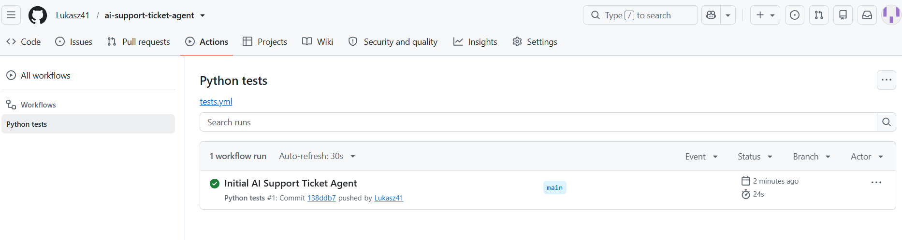
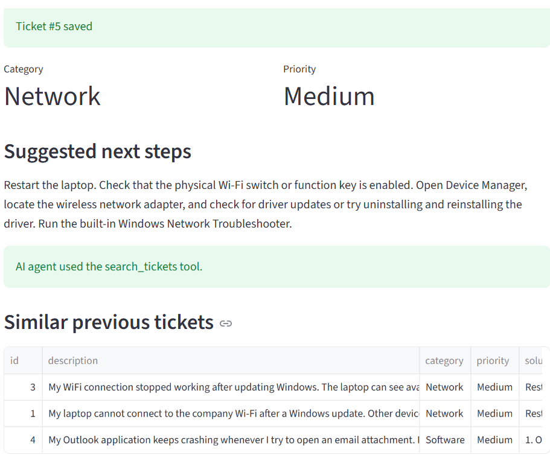
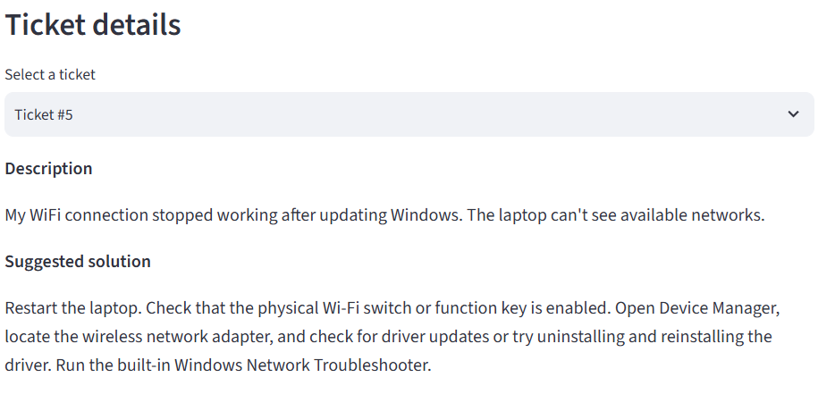
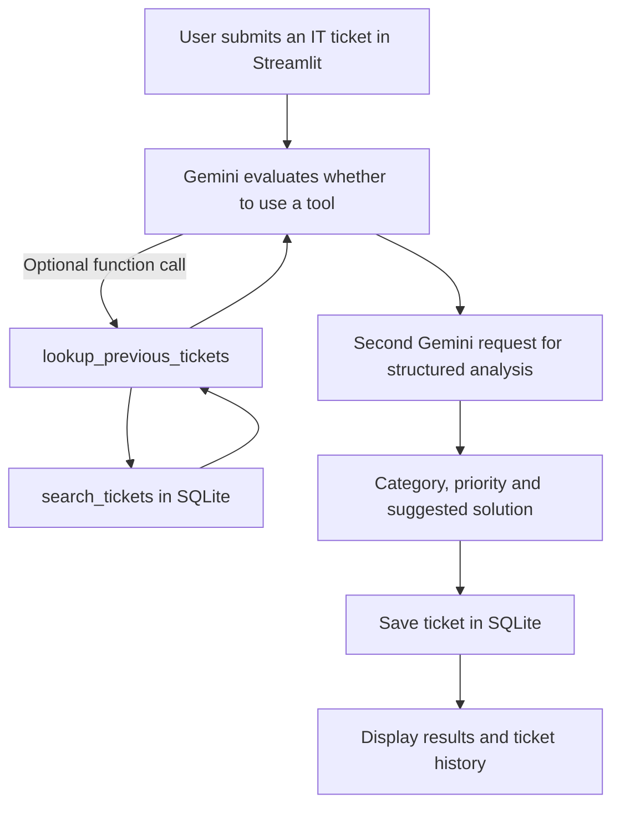

# AI Support Ticket Agent

**An AI-assisted IT helpdesk portfolio project built with Python, Google Gemini, SQLite and Streamlit.**

[](https://github.com/Lukasz41/ai-support-ticket-agent/actions/workflows/tests.yml)

The application classifies IT support tickets, suggests troubleshooting steps and stores ticket history. It demonstrates **LLM function calling**: Gemini can request a Python lookup of relevant historical tickets before producing a recommendation.

> **Portfolio / educational project.** This is not a production helpdesk service. Use fictional tickets only, and review AI-generated recommendations before acting on them.

## Screenshots

### Ticket classification and suggested actions



*An actual result from the early application version; the ticket-history layout has since been improved.*

### Automated tests on GitHub Actions




### Agent tool usage and ticket details

The AI agent uses function calling to search historical support tickets stored in SQLite. When relevant tickets are found, the application displays them to the user.

#### AI Agent – Function Calling

The screenshot below demonstrates how Gemini retrieves similar historical tickets using the search tool.



#### Ticket History and Details

Users can browse previous support tickets and select individual records to view their full descriptions and AI-generated troubleshooting recommendations.




## Key features

- **AI ticket classification:** Gemini returns a category (`Network`, `Software`, `Hardware`, `Account`, `Security`, `Other`), priority (`Low`, `Medium`, `High`) and suggested resolution.
- **LLM tool calling:** Gemini can invoke `lookup_previous_tickets(query)`; the Google Gen AI Python SDK executes the function and returns its results.
- **Historical ticket lookup:** `search_tickets()` queries local SQLite records using keyword matching.
- **Structured responses:** A separate Gemini request returns JSON fields validated by the application.
- **Streamlit interface:** Ticket submission, analysis results, search-tool feedback, ticket history and readable full ticket details.
- **Reliability:** Limited retries with exponential backoff for temporary API 503 errors.
- **Testing and CI:** `pytest` with mocked Gemini API calls; GitHub Actions executes tests on push and pull request.

## Architecture



The current lookup uses keyword overlap — **not** embeddings, semantic search or RAG. The model may choose not to call the lookup tool.

## Tech stack

| Layer | Technology |
| --- | --- |
| Application | Python 3.11–3.13 |
| LLM integration | Google Gen AI SDK / Gemini API |
| Data storage | SQLite |
| User interface | Streamlit |
| Testing | pytest |
| Continuous integration | GitHub Actions |

## Getting started (Windows 11 / PowerShell)

**Requirements:** Python 3.11–3.13, a Gemini API key, and access to the model configured in `agent.py`. Model access and free-tier quota depend on Google's current policies.

Clone and open the project:

```powershell
git clone https://github.com/Lukasz41/ai-support-ticket-agent.git
cd ai-support-ticket-agent
```

Create a virtual environment and install dependencies:

```powershell
py -m venv .venv
.\.venv\Scripts\Activate.ps1
python -m pip install -r requirements.txt
```

Create your local environment file:

```powershell
Copy-Item .env.example .env
```

Set `GEMINI_API_KEY` in `.env` to your own key. **Do not commit this file or paste its contents into an issue.**

Start the app:

```powershell
python -m streamlit run app.py
```

Then visit `http://localhost:8501` and submit a **fictional** ticket, for example:

> My laptop cannot connect to the company Wi-Fi after a Windows update. Other devices work normally.

To try historical retrieval, submit a similar (but not identical) second ticket and inspect the tool-use message and matching tickets. Tool invocation is model-driven, so it is not guaranteed on every request.

## Run tests

```powershell
python -m pytest -q
```

The repository currently includes **7 local tests** (as verified during development). Gemini responses are mocked in the agent tests, so running the test suite does not require an API key or consume Gemini requests. The CI workflow runs tests on GitHub Actions.

## Project structure

```text
ai-support-ticket-agent/
├── .github/workflows/tests.yml
├── tests/
│   ├── test_agent.py
│   └── test_database.py
├── agent.py          # Gemini integration, function calling and retry logic
├── app.py            # Streamlit UI
├── database.py       # SQLite persistence and keyword search
├── assets/
│   └── screenshots/  # Real application and CI screenshots
├── .env.example      # Example configuration (no real credentials)
├── .gitignore
├── README.md
└── requirements.txt
```

## Design choices and limitations

- **Two LLM requests:** one for optional tool calling, and a separate one for structured ticket classification. This keeps tool invocation and JSON response handling separate.
- **Simple local retrieval:** SQLite with keyword matching keeps the project small and easy to run, but may miss semantically similar tickets.
- **Non-deterministic model behaviour:** category, priority and tool-use decisions can vary; human review is necessary.
- **API availability:** model names, quotas and endpoint availability can change. If a model is unavailable, select a model supported by your Gemini project and adjust `MODEL` in `agent.py`.
- **Privacy:** ticket contents and retrieved history may be sent to Gemini. Use synthetic examples only; never submit passwords, personal information or real company incidents.

## Potential next steps

- Add semantic retrieval using embeddings.
- Build a small labelled evaluation dataset for ticket category and priority accuracy.
- Add user-controlled ticket status and filtering.
- Add an end-to-end demo video or a deployed example using safe, synthetic data.

---

**Repository:** https://github.com/Lukasz41/ai-support-ticket-agent
